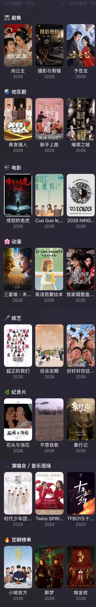

# Rex首页

Rex 影视首页：**7 大分类＋豆瓣榜单**，共 11 个模块。最新的片排最前面，每行 200 部、可翻页，各行不重复。

## 安装

| 文件 | 用途 |
|---|---|
| [`rex-home.js`](rex-home.js) | 加密后的模块脚本（`REXENC` 格式） |
| [`RexHome.rex`](RexHome.rex) | 首页布局包（iPhone、iPad），导入后直接得到上图的首页；不含明文，读取上面的加密脚本 |
| [`RexHome-Mac.rex`](RexHome-Mac.rex) | 同一个首页的 Mac 版：全宽行加高，适合 Mac 大萤幕；用同一个模块（[手机版放到 Mac 的样子](docs/rex-mac-vs-phone.jpg)） |

想要自己的首页：用 [Rex首页导出工具](https://kenxtbecdi7690.github.io/rex-home/builder/)（作者：Bolinxxlin，[介绍网页](https://kenxtbecdi7690.github.io/rex-home/export/)、[说明](Rex首页导出工具说明.md)）。iPhone 的 Rex 没有导出，可以用它从 Rex 备份导出首页；也能勾选行、调整顺序和设置，或打开别人分享的 `.rex` 照着改，再导出 `RexHome.rex`。

第一次用请看 [新手教学](新手教学.md)；想把自己的首页分享出去，看 [首页导出教学](首页导出教学.md)。代理设置见 [代理规则](代理规则.md)；`.rex` 格式与自动更新的原理见 [导入导出规则](导入导出规则.md)。

### 豆瓣密钥（可选）

不填也能用：豆瓣榜单默认匹配 TMDB 身份，有海报、能载入资源。想要更准的片名对应，再填 Douban Bridge 的密钥：

1. 用浏览器打开 <https://douban-bridge.baran.wang/rex>，**用自己的 GitHub 登录**，Star 项目后生成密钥并复制。
2. Rex → 模块设置 → Rex首页 →「豆瓣密钥（可选）」贴上，保存。
3. 长按首页的「🔥 豆瓣榜单」→「配置数据来源」→「片单模式」选「豆瓣原榜（需密钥）」。

密钥**不是豆瓣密码**，只存在自己的 Rex 里，**不要发给任何人**（包括维护者）。清空这一栏就回到不用密钥的方式。详细步骤见 [豆瓣密钥教学](豆瓣密钥教学.md)。

## 分类与更新

### 共 11 个模块

| 类别 | 模块 | 可选 |
|---|---|---|
| **7 大影片分类** | 📺 剧集 | 大陆剧 · 27 种类型（含都市、青春、谍战、刑侦、宫斗、职场） |
| | 🌏 地区剧 | 10 个地区：港台、韩国、日本、美国、英国、泰国、新马、西班牙、土耳其、印度 · 27 种类型 |
| | 🎬 电影 | 21 种类型 · 16 个地区 |
| | 🌸 动漫 | 剧集＋剧场版 · 16 个地区 |
| | 🎤 综艺 | 4 种类型 · 16 个地区 |
| | 🌿 纪录片 | 5 种主题 · 16 个地区 |
| | 🎵 演唱会／音乐现场 | 16 个地区 |
| **榜单** | 🔥 豆瓣榜单 | 21 个榜单（热门剧集、热门电影、Top 250、IMDb Top 250、院线热映等），原榜排名、完整显示 |
| **3 个功能模块** | 🎞 精选轮播 | 近一年热门，国产优先，最多 20 张 |
| | 📡 国内平台 | 腾讯视频、爱奇艺、优酷、芒果TV（首页默认关闭） |
| | 🔎 片库筛选 | 自选频道、类型、地区、10 个播出平台（首页默认关闭） |

共同设置：默认全部年份、最新在前；年份 30 个选项，从新到旧排列；每页最多 200 部，默认 200；分类缓存 30 分钟、榜单 1 小时、轮播 10 分钟。

首页 10 行：轮播 → ▶️ 继续观看 → 剧集 → 地区剧 → 电影 → 动漫 → 综艺 → 纪录片 → 演唱会 → 豆瓣榜单。

### 更新事项

按日期整理的版本说明：[2026.10.27 版](版本/2026.10.27.md)、[2026.10.24 版](版本/2026.10.24.md)

| 版本 | 内容 |
|---|---|
| 首页包 2026.10.27 | 新增 Mac 版首页 `RexHome-Mac.rex`（全宽行加高）；`RexHome.rex` 改照 Mac 版 Rex 的写法打包，内容不变；模块仍是 v151 |
| v151 | 豆瓣榜单的「榜单模式」改名「片单模式」，所有行同一个名称 |
| v150 | 剧集、电影、动漫、综艺、纪录片的「片单模式」：「豆瓣标准模式」改名「豆瓣原榜（需密钥）」，与豆瓣榜单同名 |
| v149 | 设置里的选项名称改短，「榜单模式」等参数名称不再被挤成一个字；只改名称，已导入的首页设置不受影响 |
| v148 | 豆瓣密钥说明改用 App 里的实际名称：长按豆瓣榜单 → 配置数据来源 →「榜单模式」 |
| v147 | 动漫、纪录片的剧集与电影按日期交错合并，最新在前；各行预读后面几页，加载快一倍以上，第一次打开就满 200 部 |
| v146 | TMDB 同时请求数 8 → 12，网络慢时第一次打开排得更满；发布前自动检查每个选项 200 部、首页不重复，不通过就不发布 |
| v145 | 首页各行与豆瓣榜单排满：TMDB 同时请求数 2 → 8，不再排队超时；豆瓣榜单匹配加快，年份差一年也能对上 |
| v144 | 豆瓣密钥说明写清楚：不是豆瓣密码、用 GitHub 登录取得、只存本机；榜单模式的选项名称更易懂 |
| v143 | 豆瓣榜单改用 TMDB 身份与海报（排名照豆瓣原榜），海报能显示、详情页能载入资源；已导入的首页更新模块即可 |
| v142 | 模块编号固定为 `rex.home.unified`，以后更新不用重新导入首页；模块与各分类介绍改短；国内平台读一页的请求从约 220 次降到约 60 次；清理没用到的旧代码 |
| v141 | 演唱会拿掉只有 2 部的「历史资源记录」「音乐晚会」，所有选项都到 200 部；加缓存，去重记录存到本机，App 重开后也不重复；「接着看」改回「继续观看」 |
| v140 | 豆瓣榜单改为原榜排名、不参与去重；地区剧新增新马、西班牙、土耳其、印度 |
| v139 | 港台、韩、日、美剧合成一行「地区剧」，新增英国、泰国；打开「继续观看」；各行加副标题，纪录片图标改为 🌿 |
| v138 | 首页不重复：剧集只出大陆剧，剧集类排除儿童与肥皂剧，去重后不再补回重复影片；国内平台恢复按热度 |
| v137 | 剧集新增都市、青春、谍战、刑侦、宫斗、职场类型；新增港台剧、韩剧、日剧、美剧专行 |
| v136 | 保留全部模块；各分类默认全部年份、最新在前，每页 200 部可翻页；年份选单从新到旧 |
| v134 | 首页精简为 6 行；豆瓣榜单新增奥斯卡、IMDb 电影／剧集 Top 250、意外结局电影 |

维护这个仓库（含 AI 代理）请先读 [`CLAUDE.md`](CLAUDE.md)。
