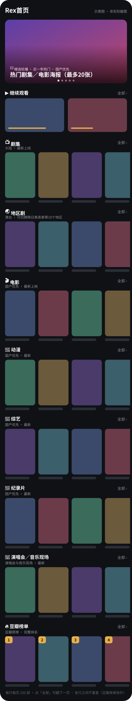

# Rex首页

Rex 影视首页：**7 大分类＋豆瓣榜单**，共 11 个模块。最新的片排最前面，每行 200 部、可翻页，各行不重复。

> 上图按首页布局绘制，为示意图，不是 App 实际截图。

## 安装

| 文件 | 用途 |
|---|---|
| [`rex-home.js`](rex-home.js) | 加密后的模块脚本（`REXENC` 格式） |
| [`RexHome.rex`](RexHome.rex) | 首页布局包，导入后直接得到上图的首页；不含明文，读取上面的加密脚本 |

想要自己的首页：用 [Rex首页编辑器](https://kenxtbecdi7690.github.io/rex-home/builder/)（GitHub Pages）勾选行、调整顺序和设置，直接导出 `RexHome.rex`；也能打开别人分享的 `.rex` 照着改。

代理设置见 [代理规则](代理规则.md)。

## 分类与更新

### 共 11 个模块

| 类别 | 模块 | 可选 |
|---|---|---|
| **7 大影片分类** | 📺 剧集 | 大陆剧 · 27 种类型（含都市、青春、谍战、刑侦、宫斗、职场） |
| | 🌏 地区剧 | 10 个地区：港台、韩国、日本、美国、英国、泰国、新马、西班牙、土耳其、印度 · 27 种类型 |
| | 🎬 电影 | 21 种类型 · 16 个地区 |
| | 🌸 动漫 | 剧集＋剧场版 · 16 个地区 |
| | 🎤 综艺 | 4 种类型 · 16 个地区 |
| | 🌿 纪录片 | 5 种主题 · 16 个地区 |
| | 🎵 演唱会／音乐现场 | 16 个地区 |
| **榜单** | 🔥 豆瓣榜单 | 21 个榜单（热门剧集、热门电影、Top 250、IMDb Top 250、院线热映等），原榜排名、完整显示 |
| **3 个功能模块** | 🎞 精选轮播 | 近一年热门，国产优先，最多 20 张 |
| | 📡 国内平台 | 腾讯视频、爱奇艺、优酷、芒果TV（首页默认关闭） |
| | 🔎 片库筛选 | 自选频道、类型、地区、10 个播出平台（首页默认关闭） |

共同设置：默认全部年份、最新在前；年份 30 个选项，从新到旧排列；每页最多 200 部，默认 200；分类缓存 30 分钟、榜单 1 小时、轮播 10 分钟。

首页 10 行：轮播 → ▶️ 继续观看 → 剧集 → 地区剧 → 电影 → 动漫 → 综艺 → 纪录片 → 演唱会 → 豆瓣榜单。

### 更新事项

| 版本 | 内容 |
|---|---|
| v142 | 模块编号固定为 `rex.home.unified`，以后更新不用重新导入首页；模块与各分类介绍改短；国内平台读一页的请求从约 220 次降到约 60 次；清理没用到的旧代码 |
| v141 | 演唱会拿掉只有 2 部的「历史资源记录」「音乐晚会」，所有选项都到 200 部；加缓存，去重记录存到本机，App 重开后也不重复；「接着看」改回「继续观看」 |
| v140 | 豆瓣榜单改为原榜排名、不参与去重；地区剧新增新马、西班牙、土耳其、印度 |
| v139 | 港台、韩、日、美剧合成一行「地区剧」，新增英国、泰国；打开「继续观看」；各行加副标题，纪录片图标改为 🌿 |
| v138 | 首页不重复：剧集只出大陆剧，剧集类排除儿童与肥皂剧，去重后不再补回重复影片；国内平台恢复按热度 |
| v137 | 剧集新增都市、青春、谍战、刑侦、宫斗、职场类型；新增港台剧、韩剧、日剧、美剧专行 |
| v136 | 保留全部模块；各分类默认全部年份、最新在前，每页 200 部可翻页；年份选单从新到旧 |
| v134 | 首页精简为 6 行；豆瓣榜单新增奥斯卡、IMDb 电影／剧集 Top 250、意外结局电影 |

维护这个仓库（含 AI 代理）请先读 [`CLAUDE.md`](CLAUDE.md)。
