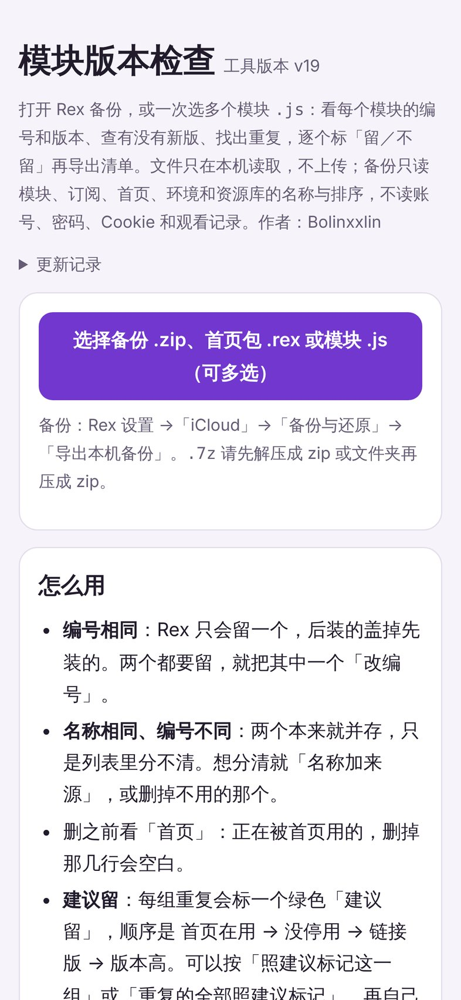
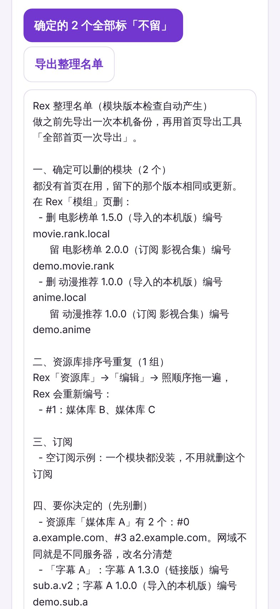
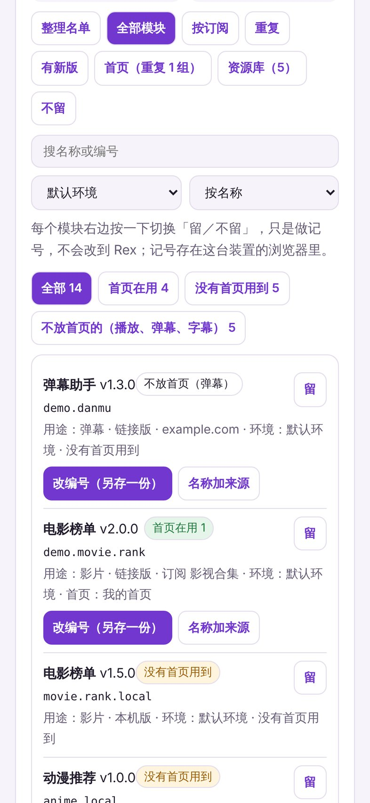
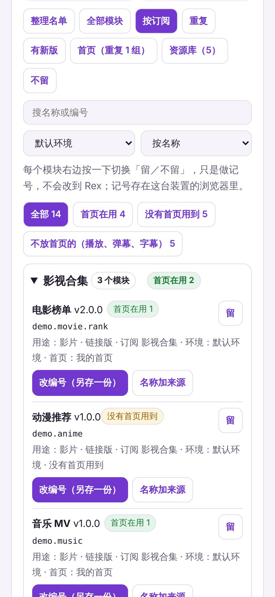
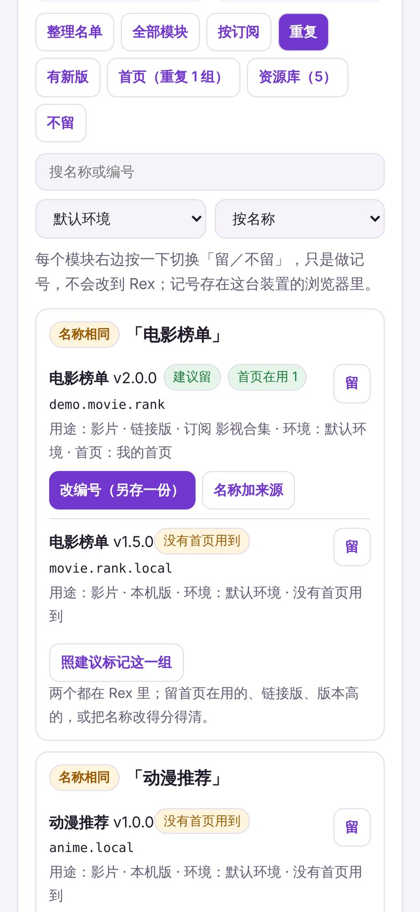
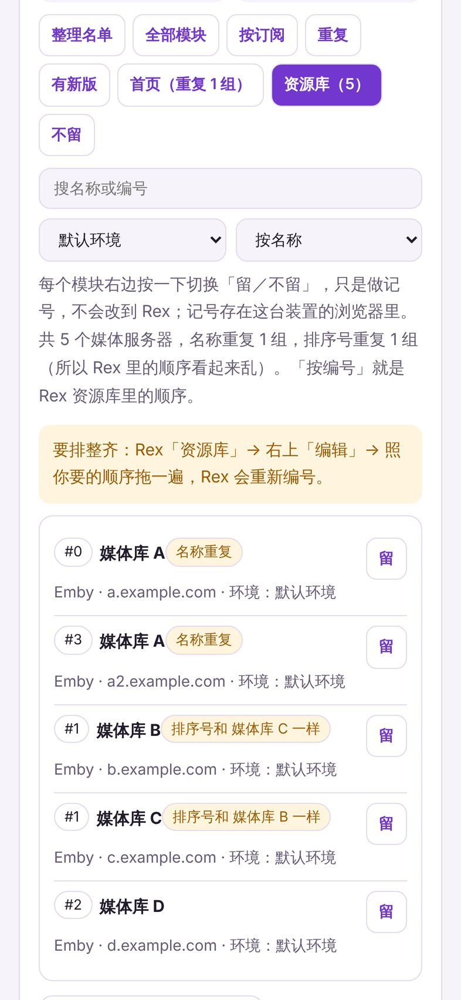
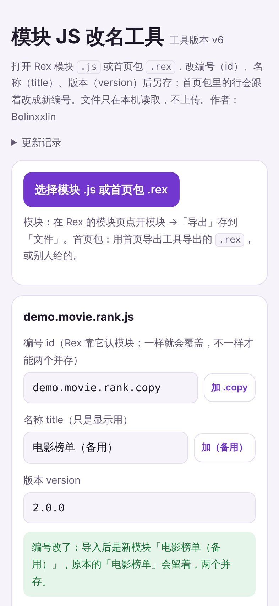

# Rex 模块整理工具

作者：Bolinxxlin · 2026.11.09

两个网页工具，iPhone、iPad、Mac 用浏览器打开就能用，文件只在本机读取，不上传。详细用法见 [模块工具教学](模块工具教学.md)。

> 下面截图用的是示范数据。

## 一、模块版本检查（v19）

<https://kenxtbecdi7690.github.io/rex-home/dupes/>

把 Rex 里的模块、订阅、资源库、首页全部列出来，找出重复的、旧版的、用不到的，告诉你哪些可以删、哪些要留。

### 怎么用

1. Rex 设置 →「iCloud」→「导出本机备份」，存到「文件」。
2. 打开工具，选那个 `.zip`（也可以选首页包 `.rex` 或模块 `.js`）。
3. 上面选「环境」，数字会跟 Rex 里对得上；排序可以按名称、编号、版本或来源。

### 各分页

| 分页 | 内容 |
|---|---|
| **整理名单** | 自动列出确定可删的模块（删哪个、留哪个）、资源库排序号重复、空订阅、要你自己决定的；可一键标「不留」，导出整理名单 |
| **全部模块** | 名称、编号、版本、用途、来源、所在环境、哪些首页在用 |
| **按订阅** | 跟 Rex 模块页一样按订阅分组，每组标几个首页在用，整组可一次留或不留 |
| **重复** | 同编号、同名称的模块，每组标「建议留」 |
| **有新版** | 按「检查新版」后列出有新版本的模块 |
| **首页** | 名称重复的首页 |
| **资源库** | 媒体服务器的排序号，标出名称重复、排序号重复 |
| **不留** | 你标了「不留」的全部项目 |

### 首页引用

每个模块旁会标：

- 🟢 **首页在用 N**：有 N 个首页用到
- 🟡 **没有首页用到**
- ⚪ **不放首页（播放、弹幕、字幕）**：这类本来就不放首页

「全部模块」「按订阅」都能按这三类筛选。「没有首页用到」可能还用在搜索或详情页，删之前想一下；播放、弹幕、字幕模块不要因为没有首页用到就删。

### 每个模块可以

- 标「留／不留」（只是记号）
- 「改编号（另存一份）」：导入后和原本的并存
- 「名称加来源」：只改名称，列表里分得清

**导出**：模块清单 CSV（Excel 可开）、不留清单、整理名单。

**注意**：只查和列清单，不会改到 Rex，删除要在 Rex 里自己按；备份只在本机读取，不上传；不读账号、密码和观看记录；加密模块（`REXENC`）改不了编号。标题下「更新记录」可看每一版改了什么。

## 二、模块 JS 改名工具（v6）

<https://kenxtbecdi7690.github.io/rex-home/rename/>

改模块 `.js` 或首页包 `.rex` 里的编号、名称和版本。改了编号，同一个模块就能存两份并存，不会互相盖掉。

