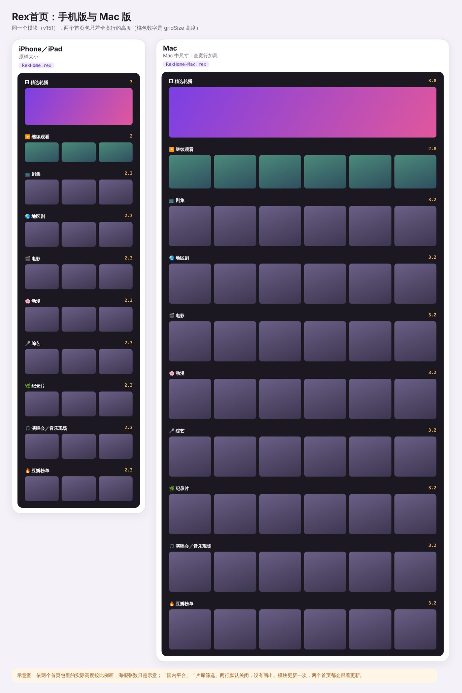

# Rex首页 2026.10.27 版

模块 v151（不变，`2026.10.24.151`）· 导出工具 2026.10.27 · 作者：Bolinxxlin

## 首页包

- 新增 **Mac 版首页** `RexHome-Mac.rex`：同一个模块，全宽行加高，适合 Mac 大萤幕
  - 轮播 3 → 3.8、海报行 2.3 → 3.2、继续观看 2 → 2.8；首页名称「Rex首页（Mac）」
- `RexHome.rex`（iPhone、iPad）改照 Mac 版 Rex 导出的写法打包；首页内容不变，已导入的不用重新导入
- 首页大小不会自己适配：iPhone／iPad 导入 `RexHome.rex`，Mac 导入 `RexHome-Mac.rex`；模块更新一次，两个首页都会跟着更新

## Rex首页导出工具

- 导出写法跟 Mac 版 Rex 一模一样（打开 Mac 导出的 `.rex` 直接导出，内容逐字相同）
- 新增「版面尺寸」：可选原样或 Mac 中尺寸
- 新增「预设配置」：一键换成 Rex 自带的预设首页
- 新增头像：显示目前头像，可换头像（自动裁成 333×333 PNG）或改用默认头像
- 打开整份 Rex 备份（测试版 1.0.2）：照 Rex 里的名称、头像、顺序列出所有首页，标出所在环境，跳过已删除的旧档
- 打开一般 zip（例如整个 `configs` 文件夹）也能列出所有首页来挑
- 原样保留分组标题行、Forward 资源库页面、其他模块的行；Rex首页模块的行只换成 GitHub 上的加密脚本
- Mac 上可以把档案直接拖进网页

## 说明文件

- [导入导出规则](../导入导出规则.md) 重新整理：首页包、头像、各行、模块与更新、Rex 备份（哪些档有账号资料、不能分享）、Forward、工具怎么处理
- 新增仓库技能 `.claude/skills/rex-home-tools`，给接手维护的人与 AI 看

## 链接

- 导入首页（iPhone、iPad）：<https://raw.githubusercontent.com/kenxtbecdi7690/rex-home/main/RexHome.rex>
- 导入首页（Mac）：<https://raw.githubusercontent.com/kenxtbecdi7690/rex-home/main/RexHome-Mac.rex>
- 模块订阅：<https://raw.githubusercontent.com/kenxtbecdi7690/rex-home/main/rex-home.js>
- 导出工具：<https://kenxtbecdi7690.github.io/rex-home/builder/>
