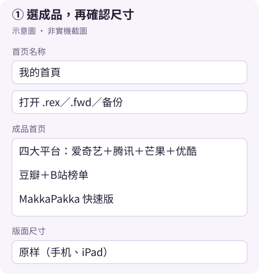
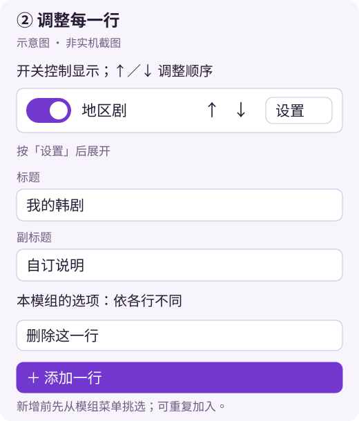
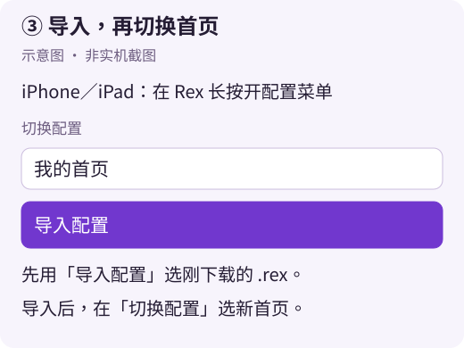
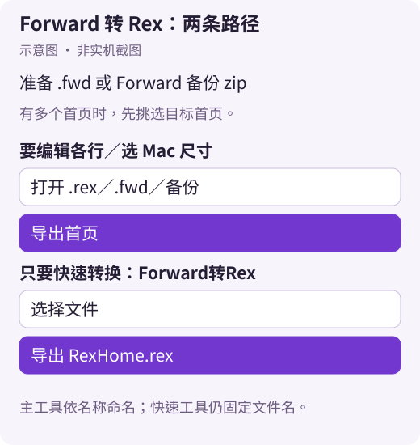

# 首頁匯出與匯入教學

2026-10-31 更新 · 作者：Bolinxxlin。依 main `22e1e8e` 的匯出工具 **2026.10.30** 整理；「」內保留介面原文。

[開啟 Rex 首頁匯出工具](https://kenxtbecdi7690.github.io/rex-home/builder/) · [手機版圖文教學](https://kenxtbecdi7690.github.io/rex-home/export/) · [完整功能說明](Rex首页导出工具说明.md)

## 1．選擇現成配置，或打開自己的首頁

沒有檔案也能操作：打開工具，在「成品首页」選「四大平台：爱奇艺＋腾讯＋芒果＋优酷」、「豆瓣＋B站榜单」或「MakkaPakka 快速版」。選取會替換目前編輯內容，請先匯出要保留的版本；成功載入後，選單回到提示文字是正常的，檢查名稱與各行即可。

要保留自己目前的首頁，改用以下方式：

| 來源 | 怎麼打開 |
|---|---|
| iPhone／iPad 的 Rex | Rex 設定 →「iCloud」→「导出本机备份」→ 儲存到「檔案」；回工具按「打开 .rex／.fwd／备份」選備份 zip，**不用解壓** |
| Mac 的 Rex／朋友分享的首頁 | 同一按鈕選 `.rex`；電腦也可拖入網頁 |
| Forward 首頁 | 同一按鈕選 `.fwd` 或 Forward 備份 zip，不必先經官方工具轉換 |
| 只有 Rex 首頁設定 JSON | 選 `payload/homes/configs/` 內不含 `.sync` 的 `.json`；名稱讀不到時自行填寫 |

讀取備份後若出現多首頁選單，挑選目標，核對行數與行名；不要只用「最新檔案」判斷。`.sync.json` 是同步記號，不能當首頁。工具不支援 `.rar` 或 `.7z`，請準備 zip 或可讀取的首頁檔。

成品載入失敗時，先檢查網路；也可到 [成品所在分支](https://github.com/kenxtbecdi7690/rex-home/tree/platform-home) 下載 `PlatformHome.rex`、`DoubanBilibili.rex` 或 `MakkaFast.rex`，再開啟檔案。

## 2．改名稱、順序與內容

1. 在「首页名称」填入例如「我的首頁」。要換圖就按「换头像」。
2. 每行的開關決定顯示與否，「↑／↓」調整位置。
3. 按「设置」改「标题」、「副标题」及該模組提供的地區、類型等選項；完成按「收起」。
4. 從底部模組選單挑選，按「＋ 添加一行」；同一模組可以加多次。
5. 刪除行要先開「设置」，再按「删除这一行」。「其他模块」行保留原設定，不能在這裡編輯資料參數；來源模組也要在 Rex 內可用。

「一键重置」、「空白模板」、「预设配置」會替換目前首頁，剛按完可點訊息中的「撤销」。這不是所有編輯操作的復原鍵；先匯出一份再大改。

## 3．選尺寸並匯出

| 使用裝置 | 「版面尺寸」選項 | 名稱填「我的首頁」時的下載檔名 |
|---|---|---|
| iPhone／iPad | 原样（手机、iPad） | `我的首頁.rex` |
| Mac，想加高全寬格子 | Mac 中尺寸（全宽行放大） | `我的首頁-Mac.rex` |
| Mac，想保留原尺寸 | 原样（手机、iPad） | `我的首頁.rex` |

至少開啟一行，再按「导出首页」。檔案**依首頁名稱命名**，不必尋找固定的 `RexHome.rex`。不合法檔名字元會被移除。原樣會保留來源尺寸；對已是 Mac 中尺寸的檔案，避免再套用加高。

## 4．在自己的裝置匯入

**iPhone／iPad：**

1. 在 Safari 下載項目或「檔案」找到剛匯出的 `.rex`，朋友收到分享時也先存到「檔案」。
2. 點檔案選用 Rex 開啟；若沒有 Rex 選項，進 Rex 長按開配置選單 →「导入配置」→ 選這個檔案。
3. 在「切换配置」確認並選擇新首頁，檢查名稱、行順序及需要的模組。

**Mac：**

1. 同一個網頁匯出；檔案在瀏覽器指定的下載位置，通常是「下載項目」。
2. 用 Rex「导入配置」選 `.rex`，再切換到新首頁。**Mac 該選項的確切位置未經本輪實機確認**，不能保證在左側欄。

特殊嵌入環境若只能存 `.zip`，只把**工具匯出的首頁包**副檔名改為 `.rex`，不要改整份備份，也不要留下 `.rex.zip`。一般 GitHub Pages 直接下載 `.rex`。

## Forward 轉換補充

要改行內容或尺寸，使用上述主工具即可。只需轉換時，也可用 [Forward转Rex](https://kenxtbecdi7690.github.io/rex-home/fwd2rex/)：

1. 按「选择档案」選 `.fwd` 或備份 zip。
2. 有多個首頁時選「备份里的首页」，核對名稱、行數，可改「首页名称」。
3. 按「导出 RexHome.rex」。**這個獨立工具仍固定輸出 `RexHome.rex`**，再按第 4 段匯入。

要匯出給 Forward 本身使用的 `.fwd`，才使用 [Forward 官方匯出工具](https://forward.inch.red/export/)。兩個 Rex 工具都不會輸出 `.fwd`，也不能靠改副檔名完成轉換。轉換不會替你登入資源庫或保證各行播放可用。

不要分享整份備份、`library-credentials.plist` 或 `preferences.plist`。首頁在瀏覽器本機處理，但網路仍用於載入成品與必要程式庫；分享 `.rex` 前也要檢查第三方行的個人網址與參數。

**驗證聲明：**本次核對程式與網頁流程，圖片為示意圖；靜態與程式層級檢查、瀏覽器受阻細節列在 PR。未完成 iPhone／iPad／Mac 的 Rex、Forward App 實機匯入與播放測試，也未實際驗證 Forward 官方匯出工具；舊教學曾記載的測試不代表此次版本已通過。

